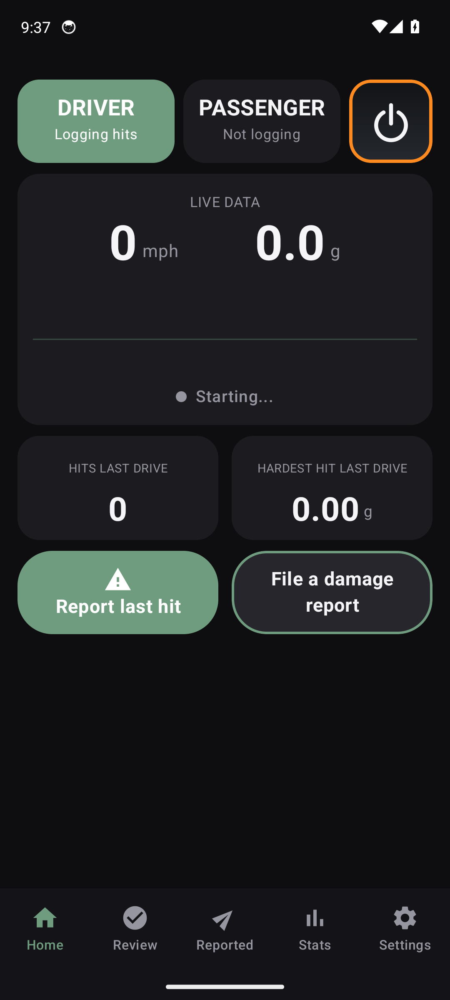
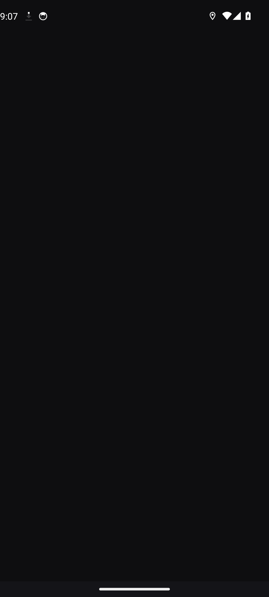
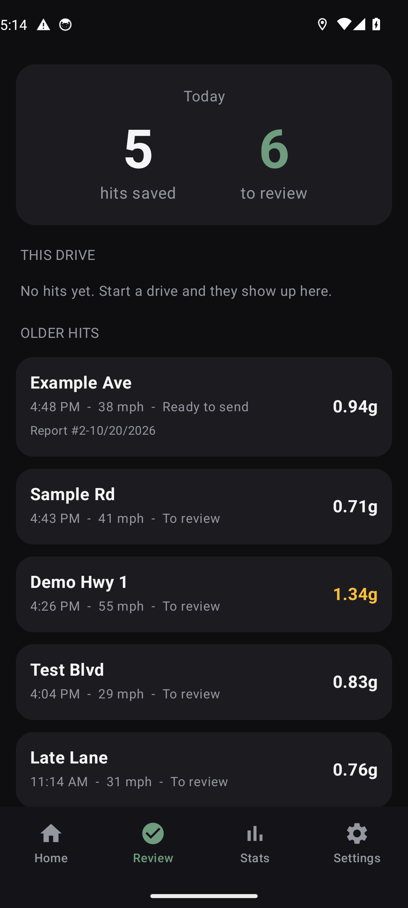
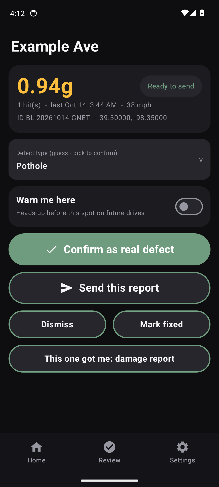
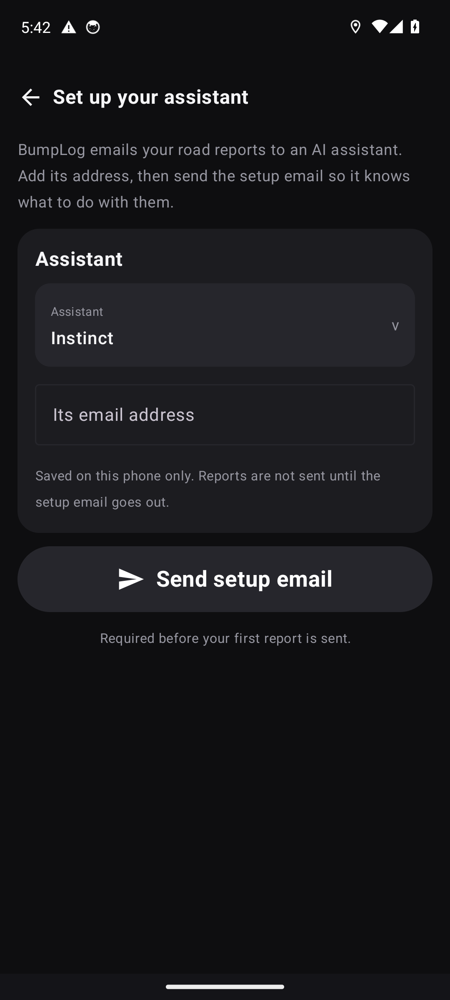
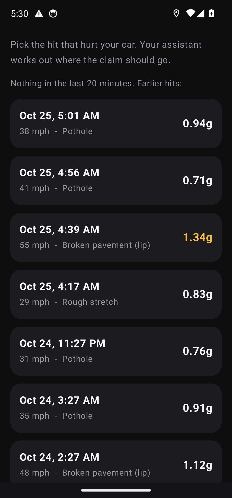
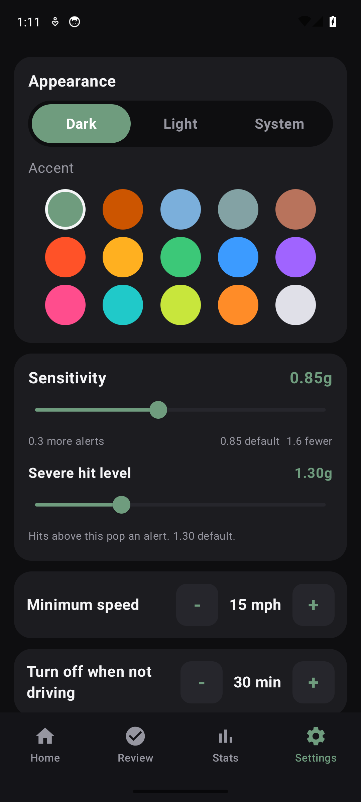
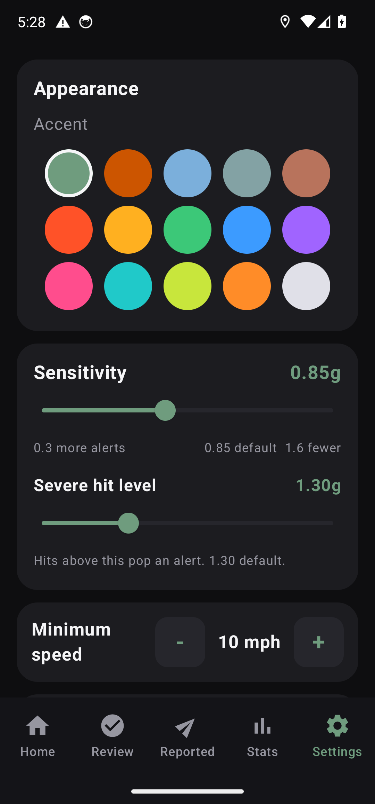
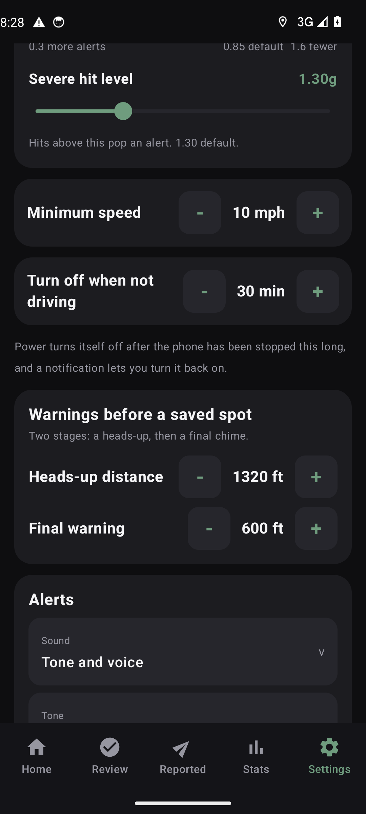

# Details

Back to the [README](../README.md).

## Screens

Captured by CI from the debug build running on an Android emulator, with demo data seeded. Visually checked for layout and text. Sensors and driving behavior are not exercised by these.

| | | | |
|---|---|---|---|
|  |  |  |  |
|  |  |  |  |
|  | | | |

## How reporting works

The app has no server and no accounts. It cannot send email by itself. **Send** opens your mail app with the report already written, addressed to your assistant, and you press send there.

- **Sent** means the report was handed to your mail app. It does not mean it arrived, and backing out of the mail app still counts as Sent - the app cannot tell the difference.
- Every confirmed spot gets a running report number: **Report #n-MM/DD/YYYY**, where the date is the day the defect was hit. Damage reports share the same counter. A number is assigned once, at the moment you confirm, and is never reused. Reports confirmed before numbers existed keep their old codes (BL-..., BD-...). Deleting all logged data keeps the counter, so new numbers continue from where they left off. A reinstall without a backup starts again at 1.
- The first report cannot go out before the one-time assistant setup: add the assistant's address and send the setup email, which carries the assistant guide. Setup never blocks driving or logging; reports wait until it is done. Settings can resend the setup email or copy the guide at any time.
- The report email has one block per defect, numbered 1, 2, 3... oldest first within the email, each labeled with the date and time it was first hit: type and severity, when it was first hit, the road, the phone's guess of town and county, the direction of travel, coordinates, and a map link. Speed, hit strength, and hit counts are never included. The email ends with a note that tells the assistant what to do and links the full assistant guide. One assistant address per report.
- Damage reports are separate emails, marked as damage claims, with the impact details and any photos you added. A damage report stands on its own and does not need a road defect report to be sent first.
- Nothing is submitted to a city or agency without your approval. The email says so to the assistant.

**Assistant picker.** Choose Instinct, Tab, or Custom. Presets are empty slots you fill in once on first setup, so the app ships with no personal addresses. Pick a preset and it fills in the address you saved. **Set up your assistant** in Settings copies the assistant guide or resends the setup email; the setup email carries the full guide. A setup link (`bumplog://setup?assistant=instinct&email=you@example.com`) opens a confirmation showing the address. Nothing is saved until you tap Use address.

## Privacy

- Logging runs on the phone. The app contacts GitHub when you open it to check for a newer version and to download it when you choose Update. We send no account or identifiers with that request, but GitHub sees your IP address like any web request. You can turn it off in Settings > Check for updates, and the app then makes no network requests of its own. The other network use is your mail app sending the email you approve, and the phone's own geocoder naming roads (optional, falls back to coordinates).
- No accounts, no analytics, no backend. Data is stored in a local database on your phone. Settings > Delete all logged data erases it.
- The Feedback entry ("General feedback, bugs, and feature suggestions") opens a screen where you see exactly what would be sent before you choose a GitHub issue or the private form. It only adds the app version, Android version, phone model, and display numbers (font scale, screen density, screen size in dp and pixels, and size class). The app does not read or attach your location, saved spots, or logs. Anything else in the report is what you type.

## Known limits

- While Power is on, GPS and the motion sensor stay on, which uses battery. Power turns itself off after the set time stopped. After a restart of the phone, open BumpLog once to resume logging. Restarting by itself after a reboot is planned for a later version.
- The auto-off and Passenger timers keep running without a GPS fix, but Passenger only switches back to Driver once a fresh fix confirms you are stopped, so it waits indoors or in a tunnel until the phone gets one. Auto-off measures time stopped, so a long dead stop on a highway can turn logging off; the notification lets you turn it back on.
- The app builds in CI and passes its unit tests. The screens render on an Android emulator (see screenshots above). Hit detection and alert timing have not been tuned on real roads.
- Car Bluetooth prompts only react to the one device you choose in Settings. They only offer: nothing starts or stops until you tap the notification.
- Hit detection uses fixed thresholds and simple pattern rules. Real mount and car tuning will change them.
- Defect-type guessing is a heuristic. Always confirm.
- "Fixed?" is offered after two clean passes through a spot. It is a suggestion, not proof.
- In-app updates: the check runs once each time the app is opened and stays quiet when offline or rate limited. A download that is interrupted, or an app restart before you finish the Android install step, abandons the update; the file is deleted and the offer comes back at the next open. The new file must be signed by the same key as the installed app, or by a key that the new app's signing history ties to it, and Android makes the final decision when it installs. If the signing key is ever changed without that history, install the new version by hand.
- No QR setup yet. The setup email and setup link cover first setup.

## Battery setup

Tap **Battery setup** in Settings. On Samsung phones also add the app to Settings > Battery > Background usage limits > Never sleeping apps, or One UI can stop it mid-drive.

## Build

```
./gradlew assembleRelease
```

Needs JDK 17 and the Android SDK 34. GitHub Actions builds the APK on every push to `main`. Publishing is a manual run with publish turned on, after review. Without the signing secrets the release build is unsigned.

## Credits

The built-in natural voice clips were generated with the Kokoro-82M text-to-speech model (Apache-2.0, https://huggingface.co/hexgrad/Kokoro-82M), run through sherpa-onnx (Apache-2.0, https://github.com/k2-fsa/sherpa-onnx).
